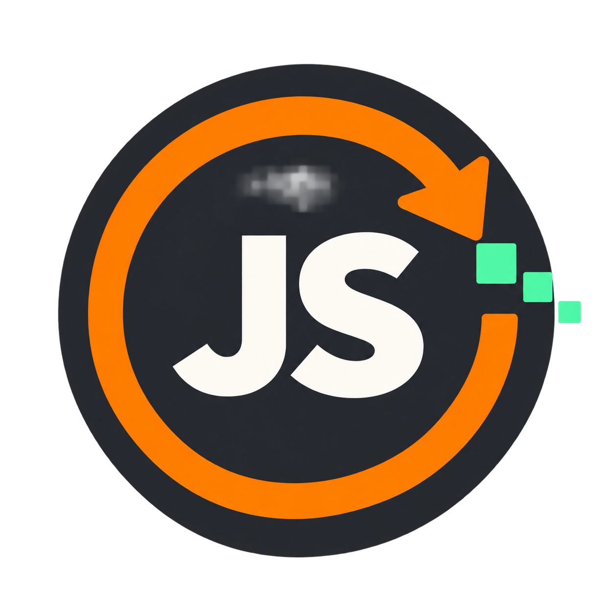

<p align="center">
  
</p>

# JumpJet

JumpJet 是以 JavaScript 實作的 JavaScript 引擎，支援部分 JavaScript 語法。程式會先編譯成 bytecode，再由自己的虛擬機執行。

## 使用方式

需要 Node.js 20 以上版本與 Python 3。在專案目錄啟動本機伺服器：

```sh
npm run dev
```

用瀏覽器開啟 <http://127.0.0.1:8000/main.html>，在左側輸入 JavaScript，按下「編譯並執行」，或按 Ctrl+Enter / Command+Enter。右側會顯示執行結果、編譯錯誤與 bytecode。

編輯器會自動保存草稿，也支援匯入與下載 `.js` 檔案。

## 支援的語法

- 變數宣告：`let`、`const`
- 基本值：數字、布林值、字串、`null`、`undefined`
- 資料結構：連續陣列、固定欄位物件、欄位與索引讀寫、陣列與字串的 `length`
- 運算：`+`、`-`、`*`、`/`、一元 `+`、一元 `-`、`!`
- 比較：`<`、`<=`、`>`、`>=`、`===`、`!==`
- 邏輯：短路運算 `&&`、`||`
- 賦值：`=` 與鏈式賦值
- 控制流程：區塊作用域、`if` / `else if` / `else`、`while`
- 函式：頂層具名函式、參數、直接呼叫、宣告前呼叫、遞迴、互相遞迴、`return`
- 其他：括號、行註解、區塊註解、字串跳脫字元

宣告與運算式敘述必須以分號結尾；`if`、`else` 與 `while` 的本體必須使用大括號。程式最後必須是運算式敘述，其值就是執行結果。

函式只能宣告在頂層，呼叫時的引數數量必須與參數數量相同。不支援閉包、回呼或將函式當作值。

## 語法範例

變數與條件判斷，結果為 `7`：

```js
let score = 3;
if (score < 5) {
	score = -score + 10;
} else {
	score = 0;
}
score;
```

陣列、物件與迴圈，結果為 `6`：

```js
const numbers = [1, 2, 3];
const result = { total: 0 };
let i = 0;
while (i < numbers.length) {
	result.total = result.total + numbers[i];
	i = i + 1;
}
result.total;
```

函式與遞迴，結果為 `120`：

```js
function factorial(n) {
	if (n <= 1) {
		return 1;
	}
	return n * factorial(n - 1);
}
factorial(5);
```
