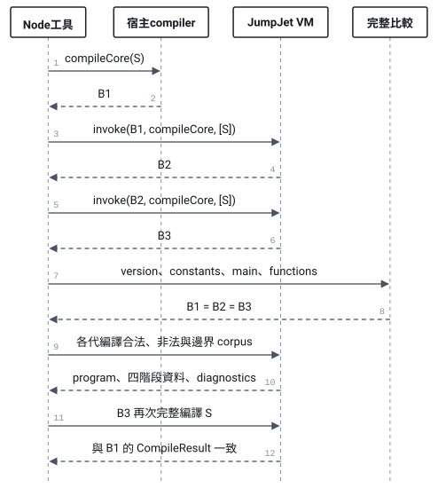
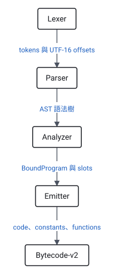

# Compiler 自舉實作與驗收紀錄

實作對應 [spec 0005](../specs/0005-self-hosting-compiler.md)。實際語言與 ABI 定義在 [Bootstrap 契約](../specs/0005-bootstrap-contract.md)。

[開啟完整視覺化說明](../self-hosting-implementation.html)，查看模組變更、JavaScript 語法支援、VM 呼叫與自舉影響。頁面包含 5 張 SVG，支援目錄導覽、深淺色與主題切換。

| 階段 | 實作與可重跑證據 |
|---|---|
| M0 | 契約列出 grammar、runtime symbols、bytecode v2、scope、frame、encoding 與限制。固定 manifest 與獨立 corpus 已建立。 |
| M1 | 四個 compiler phase 改為頂層具名函式與明確 context。`src/compiler-core.js` 不依賴 VM；manifest 只收錄七個 compiler 模組。`npm run build:bootstrap` 重建 S，`npm run check:bootstrap` 檢查子集。 |
| M2 | String、null、undefined、dense array、固定欄位 record、member read/write、while 與短路運算都有 source-to-VM 測試。資料迴圈結果為 6。 |
| M3 | 預收集函式簽章、獨立 local slots、global slots、call frames、遞迴與 `invoke` 已加入。遞迴及互相遞迴的 locals 測試得到 15。 |
| M4 | 正式驗收透過 VM 分別呼叫 `tokenize`、`parse`、`analyze`、`emit`，比對 tokens、AST、bound program 與 bytecode。S 與 corpus 均參與比對。 |
| M5 | 同一 S 建立 B1、B2、B3，逐欄位比較全部 executable schema。三代都執行 corpus，B3 另完整編譯 S。 |
| M6 | `npm run verify:self-hosting` 串接回歸、syntax check、兩個 demo 與自舉驗收。有限預算、worker deadline、失敗重現與第一個差異欄位均有測試。Studio 另有可重跑的真實瀏覽器冒煙腳本。 |

同一份 S 共 49 個具名函式。自編譯約使用 1,331 萬條 guest 指令、2,319 萬單位計費工作，最高 57 層函式。深度 diagnostic corpus 需要 643 層 guest 函式，因此自舉 call-depth 固定為 1,024，來源與 AST 深度仍為 128。

自舉每次呼叫最多使用 100,000,000 單位工作。字串操作、資料建立與邊界複製依實際長度計費。整體 worker deadline 為 60 秒；父程序可終止 worker，worker 也會在階段與呼叫完成時檢查實際經過時間。計時使用 monotonic `performance.now()`，避免系統 UTC 時鐘校正造成誤判；此行為另有回歸測試。一般 `run` 的預設預算維持 1,000,000。

Bytecode v2 明確包含 functions 表。Verifier 檢查所有函式與不可達指令，執行時使用私有快照。VM 以 Set 保存 slot 初始化狀態，且 opcode metadata 必須為 instruction table 的 own entry。這兩項都有宿主 array prototype 汙染的回歸測試。

`tests/self-hosting-failures.test.js` 會實際啟動命令，驗證執行預算與 deadline 超額時退出碼為 1。另一案例修改 reference artifact 的函式 arity，確認完整比較會回報該欄位並保存兩份資料。重跑會清除已知的舊驗收產物，避免把上次的世代或失敗證據混入本次結果。

正式驗收報告保存在 `output/self-hosting/verification/report.json`。其中包含每次 guest 呼叫的世代、入口、案例、指令數、計費工作、builtin 呼叫次數與最高 frame 深度。來源、manifest、摘要、三代完整產物與 corpus 結果保存在同一目錄。產物可由命令重建，因此不納入版本控制。

Studio 的 `scripts/studio-smoke.mjs` 在真實瀏覽器依序驗證舊控制流、非法來源、資料迴圈與遞迴，也檢查 console error 與 page error。結果保存在 `output/playwright/studio-smoke.json`，畫面為 `output/playwright/self-hosting-implemented.png`。執行方式見 README。

本次實作保留 Node 與 Studio 的來源層級用法。Closure、callback、函式當值、guest 例外處理與執行期 ES module loader 仍不在此階段範圍內。

2026-10-17 最終驗收：`npm run verify:self-hosting` 通過 171 個測試、37 個檔案的 syntax check、兩個 demo 與 643 項自舉檢查。自舉部分耗時約 5.7 秒。另讀回磁碟上的 B1、B2、B3，確認 encoding 完全相同且各自通過 verifier；讀回的 B3 可編譯資料程式並由 VM 得到 5。Studio 四個冒煙案例通過，console 與 page errors 均為空。


## SVG 導讀與圖檔

三代流程展示同一來源 S 如何由宿主建立 B1，再由 VM 建立 B2、B3。



四階段圖對照 compiler 各模組的輸入與輸出。



其他圖檔可獨立開啟或放入文件：

- [遞迴的 call frames](../assets/self-hosting-implementation/03-call-frames.svg)。
- [Guest compiler 與宿主執行邊界](../assets/self-hosting-implementation/04-host-boundary.svg)。
- [三層驗收證據](../assets/self-hosting-implementation/05-acceptance-proofs.svg)。

## 視覺化頁面如何重建

內容稿為 `docs/plans/self-hosting-visualized.am.md`。
`render-self-hosting-report.mjs` 讀取 report、B1/B2/B3 與目前 manifest，確認來源及產物摘要一致，再填入數字。
171 個回歸測試與 37 個 syntax check 檔案是上述驗收紀錄的歷史數字。
它們不是 report.json 的欄位，也不是新增說明頁後重跑得到的數字。

```sh
node scripts/render-self-hosting-report.mjs
```

這個工具預設使用已安裝的 answer-me-with-html skill renderer。
其他位置可透過 `--renderer /path/to/am.mjs` 指定。
僅更新內容與資料快照時，可使用 `--prepare-only`。

圖形由 renderer 排版；獨立 SVG 從瀏覽器中的實際圖形匯出。
SVG 匯出會保存計算後的樣式，讓圖檔不依賴 HTML 頁面的 CSS。
啟動本機伺服器並以 Playwright CLI 開啟說明頁後，可重跑排版及互動檢查：

```sh
playwright-cli open http://127.0.0.1:8000/docs/self-hosting-implementation.html
playwright-cli run-code "$(node scripts/inspect-self-hosting-report.mjs)" --json > /tmp/jumpjet-report-browser.json
node scripts/export-self-hosting-diagrams.mjs /tmp/jumpjet-report-browser.json
```

檢查包含 8 個章節、5 張 SVG、表格欄位、桌面與手機頁寬，以及目錄、主題和深淺色切換。
資料快照位於 `docs/assets/self-hosting-implementation/evidence.json`。
瀏覽器檢查摘要位於 `output/playwright/self-hosting-report-check.json`。
