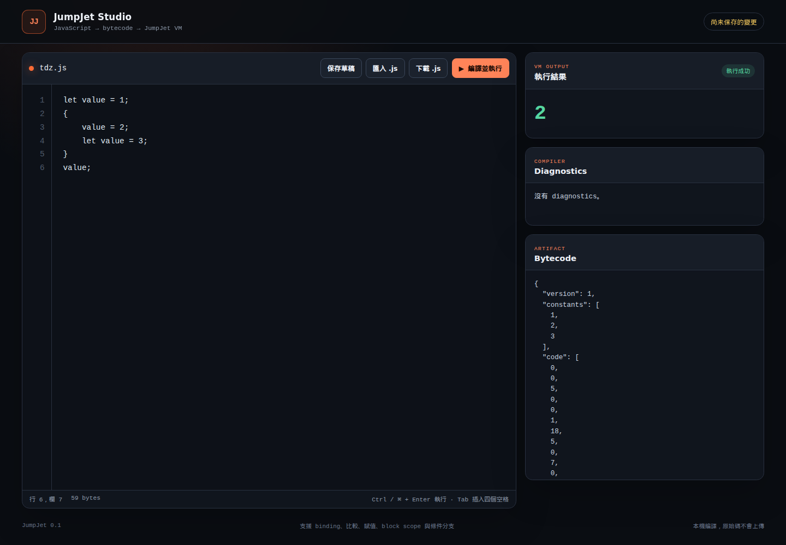
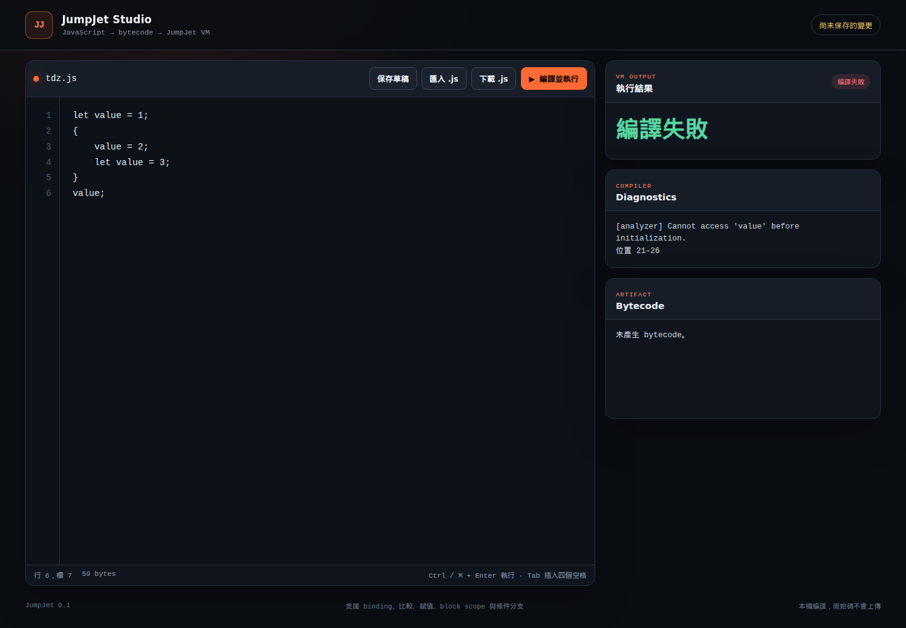
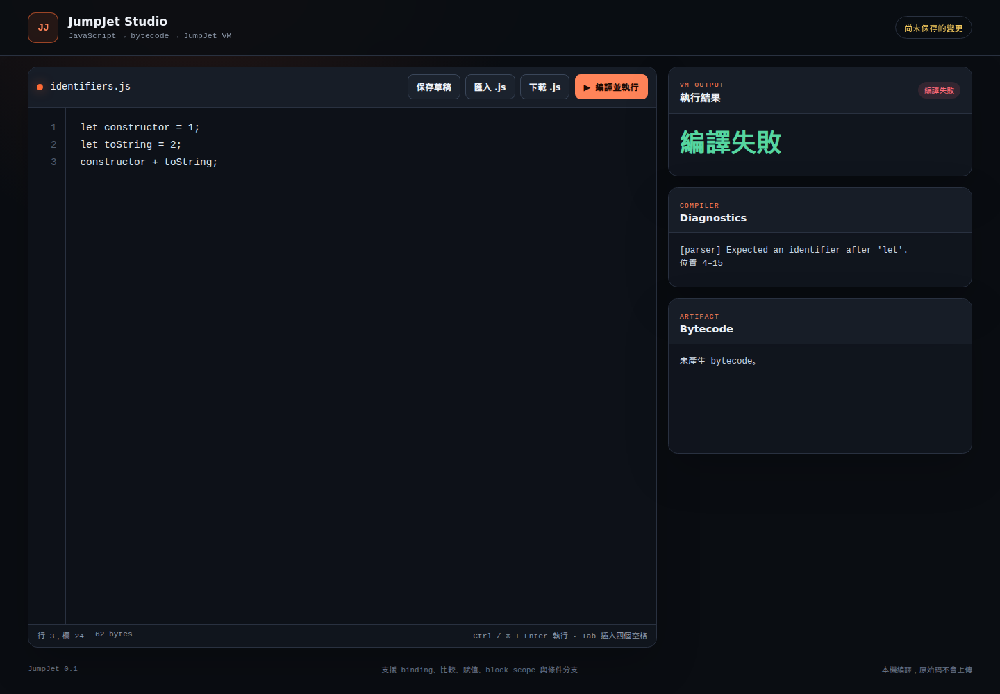
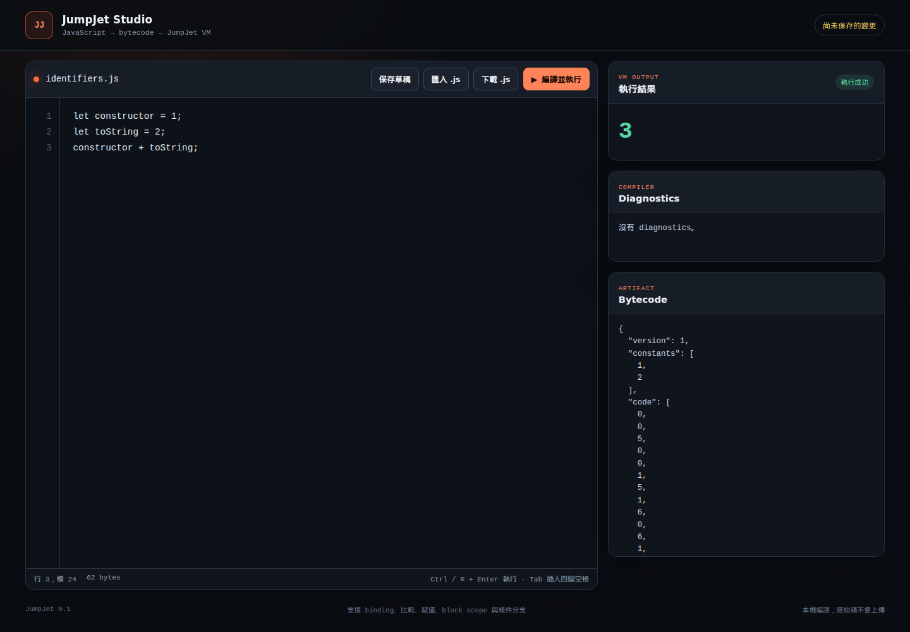
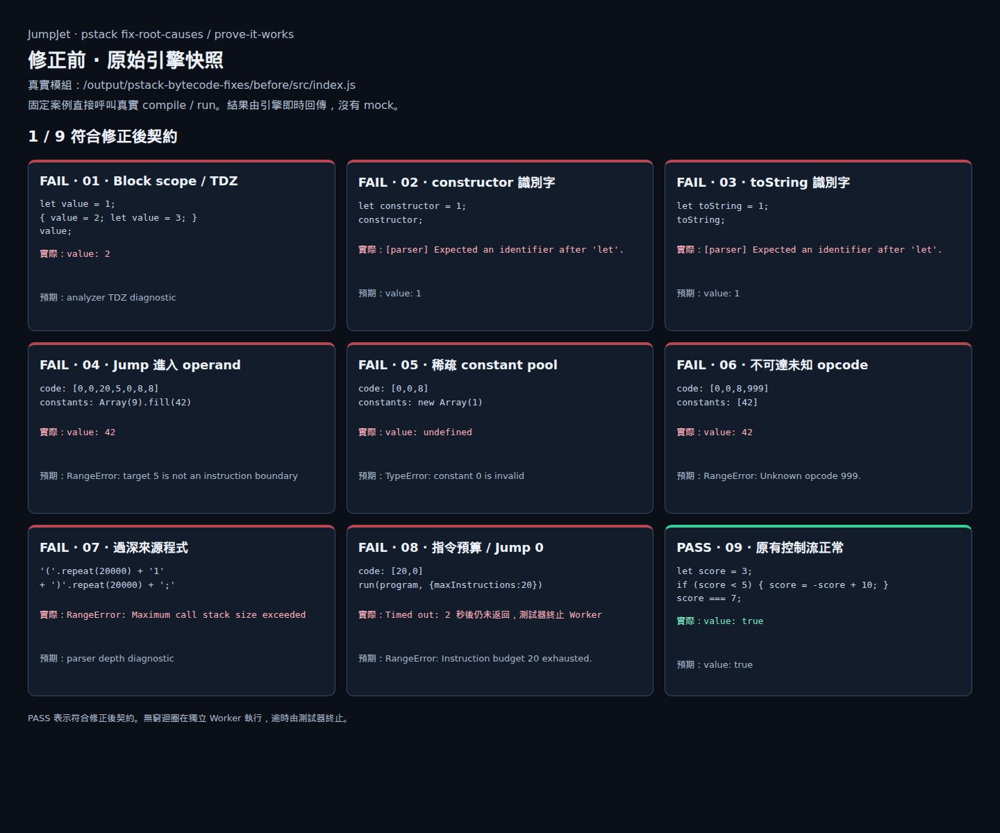
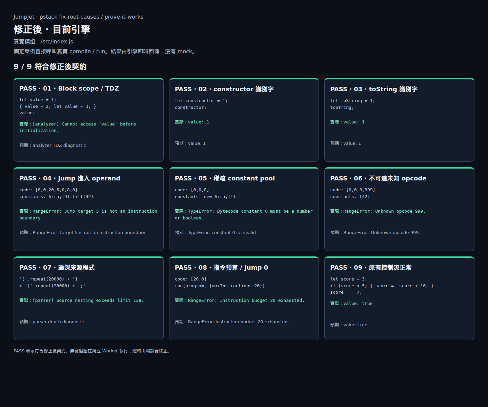

## A 已修正上一輪發現的缺口

本次使用 pstack 的 fix-root-causes 與 prove-it-works 原則。
先建立失敗測試，再修改各問題所屬的模組。
原先 23 項失敗測試現在全部通過。

| 證據 | 修正前 | 修正後 |
|---|---|---|
| 首批 29 項回歸測試 | 6 通過，23 失敗 | 29 通過 |
| 擴充後的邊界測試 | 首批完成後新增 17 項 | 46 通過 |
| 完整測試 | 保留首批失敗紀錄 | 94 通過，0 失敗、0 跳過 |
| 瀏覽器固定案例 | 1／9 符合修正後契約 | 9／9 符合修正後契約 |
| 逐檔語法檢查 | 本輪最終檢查 | 20 個 JavaScript 檔案通過 |

下方圖片都是真實瀏覽器截圖。
Studio 圖片來自實際編輯器。
VM 圖片來自直接呼叫真實模組的測試頁。
所有前後對照使用相同輸入，沒有 mock 引擎結果。

[修正前測試紀錄](tests-before.txt) · [完整測試紀錄](tests-after.txt) · [最終驗證輸出](verification.json)

## B 問題與根因的修正

| 問題 | 修正前實際結果 | 修正後實際結果 | 根因修正 |
|---|---|---|---|
| 內層宣告前賦值 | 錯誤寫入外層，返回 2 | analyzer 回報 TDZ | 進入 scope 時先建立直接宣告 |
| constructor、toString | parser 誤報名稱不合法 | 正常編譯並返回 1 | lexer 只查 keyword 表自己的 key |
| Jump 指向 operand | 把 operand 當指令，返回 42 | 拒絕非指令邊界的 target | 先完整解碼，再檢查 target |
| 稀疏 constants | 返回 undefined | 拒絕 constant 0 | 逐 index 檢查 own cell 與值型別 |
| Return 後未知 opcode | 未檢查，返回 42 | 拒絕 opcode 999 | 驗證完整 code，包含不可達區段 |
| 20,000 層括號 | 拋出宿主 stack overflow | parser 回報深度上限 | 遞迴限制與 AST 深度檢查 |
| Jump 0 | 持續執行，測試器必須終止 | 指令預算用完時拋出 RangeError | VM 計算實際執行的 opcode 數 |

另外補上 inherited array cell、未執行分支與缺少 operand 的驗證。
VM 執行私有快照，避免驗證後再讀到不同的 getter 值。
Studio 的錯誤邊界也涵蓋整個編譯與執行流程。

## C Studio 的實際畫面

點選圖片可開啟原尺寸。
左欄是保存的原版，右欄是修正後的工作目錄。

### TDZ：錯誤返回 2，改為拒絕初始化前賦值

| 修正前 | 修正後 |
|---|---|
| <a href="../playwright/bytecode-fixes/tdz-before.png"></a> | <a href="../playwright/bytecode-fixes/tdz-after.png"></a> |

這段程式本來就不合法。
修正後顯示編譯失敗，表示 analyzer 正確阻止錯誤綁定。

### 合法識別字：編譯失敗，改為正常返回 3

| 修正前 | 修正後 |
|---|---|
| <a href="../playwright/bytecode-fixes/identifiers-before.png"></a> | <a href="../playwright/bytecode-fixes/identifiers-after.png"></a> |

兩張圖都執行 constructor 為 1、toString 為 2 的相同程式。

## D VM 與來源深度的完整前後對照

| 修正前：1／9 符合契約 | 修正後：9／9 符合契約 |
|---|---|
| <a href="../playwright/bytecode-fixes/engine-before.png"></a> | <a href="../playwright/bytecode-fixes/engine-after.png"></a> |

原版頁面載入 before/src/index.js。
修正後頁面載入 repo 的 src/index.js。
兩者共用同一份測試頁程式。

Jump 0 在獨立 Worker 執行。
原版執行 2 秒後仍未返回，由測試器終止。
修正後由 VM 自己在 20 條指令後停止。
這項結果不依賴測試器的逾時機制。

[原版逐項結果](browser-before.json) · [修正後逐項結果](browser-after.json) · [真實測試頁程式](../playwright/bytecode-fixes/engine-evidence.js)

## E 修正後的責任邊界

```flow LR
source -> parser: 限制語法與 AST 深度
parser -> analyzer: 預先建立 scope 宣告
analyzer -> compiler: 綁定完成的 slot
compiler -> verifier: 完整 bytecode
verifier -> VM: 驗證後的私有快照
VM -> result: 指令預算內返回
```

新增的 verifier 專門檢查 bytecode 結構。
VM 保留執行期 stack 與 slot 初始化檢查。
opcode metadata 同時提供 operand kind 與 stack effect。
版本 1 的 opcode 數值維持相容。

來源巢狀深度與 AST 深度上限都是 128。
預設指令預算為 1,000,000，呼叫者可明確指定。

```js
run(program, { maxInstructions: 1000 });
```

這個預算限制 VM 指令數，不是整個編譯流程的時間上限。
Studio 仍同步執行，尚未新增 Worker 中止按鈕。
函式、closure 與 debugger 是後續功能，這次沒有加入。

[邊界契約規格](../../docs/specs/0004-engine-boundaries.md) · [verifier](../../src/verifier.js) · [VM](../../src/vm.js)

## F 重跑證據與檢查範圍

在 repo 根目錄執行這個指令：

```sh
node output/pstack-bytecode-fixes/verify.mjs
```

腳本執行完整測試、逐檔語法檢查與兩個 demo。
腳本也執行獨立檢查者保存的比對程式。

獨立檢查包含 800 組來源深度案例。
另有 500 次 Node.js 語意比對，涵蓋七種不同程式。
這些有限案例不能證明所有可能的程式都正確。

瀏覽器另驗證 20,000 層括號的 diagnostic。
錯誤後再執行 6 * 7，仍正確返回 42。
測試也模擬 compile 拋出例外，確認 UI 清除舊 bytecode。
這個模擬只測試 UI 邊界，沒有用於任何對照截圖。
測試過程沒有未處理的 page error。

照片的重拍流程保存在 capture-ui.js 與 capture-engine.js。
啟動 repo 根目錄的本機伺服器，port 設為 8765。
透過 Playwright CLI 載入腳本，即可重拍相同案例。

[回歸測試](../../tests/engine-boundaries.test.js) · [瀏覽器驗證輸出](ui-verification.json) · [獨立檢查](review.md)

[Studio 重拍腳本](../playwright/bytecode-fixes/capture-ui.js) · [VM 重拍腳本](../playwright/bytecode-fixes/capture-engine.js) · [來源與照片 SHA-256](manifest.json)

before 目錄保留本輪修改前的 source 與 Studio。
manifest 保存來源與照片雜湊，供後續核對。
原版快照、照片與驗證紀錄一併保存於版本控制。
